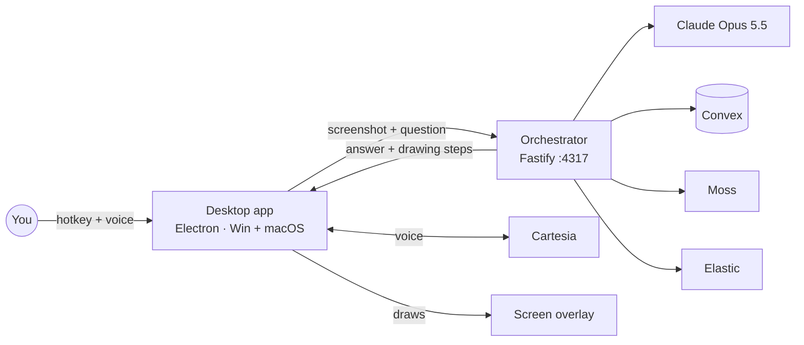

# ScreenTutor AI

**An AI math tutor that sits next to your cursor, looks at your screen only when you ask, explains out loud, and works the problem on your screen like a teacher at a whiteboard.**

Built at **Cal Hacks 13.0** · Runs on **Windows and macOS** · Electron + React · Claude Opus 5.5

---

## What it does

Hold **Ctrl+Shift+E** (macOS: **Cmd+Shift+E**), ask about a math problem on your screen, and let go.

- **Explains by voice.** The answer is spoken with Cartesia's streaming voice, and your question is transcribed live while you hold the key.
- **Draws on your screen.** A transparent overlay points at the parts it's talking about, marks the diagram (arrows along sides, right-angle marks, circles), and writes each line of working, from the setup to the answer, in the blank space beside the problem.
- **Works the whole problem.** Every step is explained in words and shown on the diagram, from setting up the equation to checking the answer.
- **Remembers how you're doing.** The concepts you ask about and your session history are stored in Convex, so follow-up questions keep their context.
- **Private by default.** The screen is captured only when you ask, sensitive windows (banking, passwords, email…) are blocked, logs are redacted, and screenshots are never stored.

## Scope

ScreenTutor currently focuses on one thing: explaining and solving **math problems** visually. The code is organized so new subjects can be added later as their own lesson prompts (see `MATH_LESSON_PROMPT` in `services/orchestrator/src/prompts/tutor-system-prompt.ts`), on the way to helping people learn anything on the internet interactively.

## Sponsor technology

| Sponsor | Used for |
|---|---|
| **Anthropic** | Claude Opus 5.5 reads the screenshot and writes the explanation and drawing steps |
| **Cartesia** | Sonic text-to-speech and Ink speech-to-text, both streamed over WebSocket |
| **Convex** | Learner profiles, weak concepts, session history and the response cache |
| **Moss** | Semantic cache: a reworded question about the same screen gets the earlier answer instantly |
| **Elastic** | OpenTelemetry traces of every tutoring step, with latencies and quality checks |

Details for each: [docs/sponsor-integrations.md](docs/sponsor-integrations.md).

## How it works



The full picture, including the drawing protocol and the Windows/macOS platform layer: [docs/architecture.md](docs/architecture.md).

## Repository layout

```
apps/desktop/            Electron app: Buddy window, overlay, hotkeys, capture, voice
  src/main/              Main process (per-OS backends: *.win32.ts / *.darwin.ts)
  src/renderer/          React UI and the drawing overlay
services/orchestrator/   Fastify API: Claude, memory, cache, tracing
  convex/                Convex schema and functions for learner memory
  src/__tests__/         Test suite (Vitest)
packages/shared/         Shared schemas, tag parser, coordinate math, redaction
docs/                    Architecture, sponsor details, privacy, demo script, team plan
```

---

## Getting started

### Requirements

- **Node.js 22+**
- **pnpm 11+** (`npm install -g pnpm`)
- An **Anthropic API key** (required). Every other service is optional and falls back to a local version.

### 1. Install

```bash
git clone https://github.com/pgala3183/CalHacks13.0.git
cd CalHacks13.0
pnpm install
cp .env.example .env
```

Then put your keys in `.env` (see [Configuration](#configuration)).

> **Windows PowerShell:** use `npx.cmd` and `pnpm.cmd` if you see "running scripts is disabled", and run commands one at a time or separate them with `;` instead of `&&`.

### 2. Start learner memory (Convex, optional)

```bash
cd services/orchestrator
npx convex dev
```

Copy the deployment URL it prints into `CONVEX_URL` in `.env`. Pick any long random value for `SCREENTUTOR_CONVEX_SECRET`, put it in `.env`, and set it on Convex too:

```bash
npx convex env set SCREENTUTOR_CONVEX_SECRET <same value>
```

Leave `npx convex dev` running.

### 3. Run the app

From the repo root:

```bash
pnpm dev
```

This starts the orchestrator on port 4317 and opens the desktop app. Check that everything is connected:

```bash
curl http://localhost:4317/api/sponsors/status
```

Each configured service should report `real`.

---

## Configuration

All settings live in `.env`; [.env.example](.env.example) lists every one with comments. The main ones:

| Variable | Required | What it does |
|---|---|---|
| `ANTHROPIC_API_KEY` | **Yes** | Claude reads the screenshot and writes the explanation |
| `CLAUDE_SPEED` | | `fast` (default): Opus fast mode, about 2.5× faster at a higher price; `standard` to save cost |
| `CLAUDE_MODEL` / `CLAUDE_EFFORT` | | Defaults `claude-opus-5-5` / `low` |
| `CARTESIA_API_KEY`, `CARTESIA_VOICE_ID` | | Streaming voice in and out (falls back to the system voice) |
| `CONVEX_URL`, `SCREENTUTOR_CONVEX_SECRET` | | Persistent learner memory (falls back to in-process memory) |
| `MOSS_PROJECT_ID`, `MOSS_PROJECT_KEY` | | Semantic answer cache |
| `ELASTIC_OTLP_ENDPOINT`, `ELASTIC_API_KEY` | | Send traces to Elastic |
| `SENTRY_ENABLED`, `SENTRY_DSN` | | Error reporting |

Settings are read at startup, so restart `pnpm dev` after changing `.env`.

### Speed

Measured on a geometry screenshot, time to the full answer:

| Setup | Time |
|---|---|
| Opus 5.5, standard | 16.7 s |
| **Opus 5.5, fast mode (default)** | **6.7 s** |
| Sonnet 5.5, `CLAUDE_THINKING=off` | 8.6 s |
| Haiku 5.5, `CLAUDE_THINKING=off` | 4.5 s |

---

## Development

| Command | What it does |
|---|---|
| `pnpm dev` | Orchestrator + desktop app with hot reload |
| `pnpm test` | Orchestrator test suite (Vitest) |
| `pnpm typecheck` | Type-check every package |
| `pnpm build` | Production build of all packages |
| `pnpm dist:win` / `pnpm dist:mac` | Windows installer / macOS `.dmg` (in `apps/desktop/release/`) |

CI runs typecheck, tests and build on Windows and macOS for every push and pull request ([.github/workflows/ci.yml](.github/workflows/ci.yml)).

The current team plan, with diagnostics and who owns what, is in [docs/fix-plan.md](docs/fix-plan.md).

---

## macOS notes

- **Permissions:** Screen Recording (capture) and Microphone (voice) are requested on first use. Their status is logged at startup as `[Permissions] ...`.
- In `pnpm dev`, permissions belong to the **Electron** binary (or your terminal app), not ScreenTutor. After granting Screen Recording, quit and relaunch; macOS only applies it on restart.
- **Distributing a `.dmg`:** unsigned builds need right-click → Open the first time; sharing with others needs an Apple Developer ID certificate and notarization.

## Privacy

- **Capture only on request.** No background recording or polling of your screen.
- **Sensitive windows are blocked.** Analysis stops if the active window matches the denylist (passwords, keychain, banking, email, payments…), or when privacy mode is on.
- **Redaction everywhere.** API keys, passwords, emails, card numbers and URL query strings are scrubbed from logs, traces, error reports and debug views.
- **Screenshots are never stored.** They're processed in memory; only an MD5 hash is kept with session history.

More in [docs/privacy-and-safety.md](docs/privacy-and-safety.md).

---

## Troubleshooting

**`Failed to reach Convex, falling back to InMemoryService`**
`CONVEX_URL` is wrong, `npx convex dev` isn't running, or the secret doesn't match. The app keeps working with in-process memory. Re-run `npx convex env set SCREENTUTOR_CONVEX_SECRET <value>` with the value from `.env`.

**`Error: Electron uninstall` when starting the app**
Electron's binary wasn't downloaded during install. Run `node node_modules/.pnpm/electron@*/node_modules/electron/install.js`, then `pnpm dev` again.

**`ERR_PNPM_MINIMUM_RELEASE_AGE_VIOLATION` during `pnpm install`**
pnpm refuses packages published less than a day ago. Pin the flagged package to its previous version under `overrides:` in `pnpm-workspace.yaml` (see the existing `node-abi` entry) rather than disabling the check.

**Hotkey not working**
On macOS, if push-to-talk never starts, set `SCREENTUTOR_HOTKEY_MODE=toggle` in `.env` (press once to start, again to stop). On Windows, run as Administrator if a fullscreen app intercepts the hotkey.

**Screen capture is black or empty (macOS)**
Grant **Screen Recording** in System Settings → Privacy & Security, then quit and relaunch the app.

**`listen EADDRINUSE :::4317`**
Another process is using port 4317. Set `ORCHESTRATOR_PORT` in `.env` to a free port.

---

## Team

Built at Cal Hacks 13.0 by Pratham Gala, Dev Mulchandani and Andre Agle.
