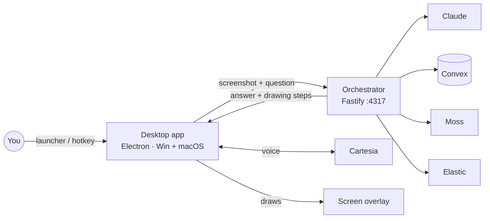

# Quicky.AI

**Your AI tutor, right on your screen.**

Quicky.AI is a desktop AI math tutor for **Cal Hacks 13.0**. It lives next to your cursor: ask about a problem on your screen (or type it), get a step-by-step explanation, watch compact annotations appear on the page, and hear each step narrated—then ask a follow-up in context.

Built for **Windows and macOS** · **Electron + React + TypeScript** · Local **Node.js orchestrator** · **Claude** (when configured) · Optional **Cartesia** voice

> **Brand:** The product is **Quicky.AI** (not Quicke.AI). Internal packages, env vars, IPC, and storage may still use the legacy `screentutor` / `@screentutor/*` identifiers for compatibility—that is intentional.

UI handoff for teammates: [docs/QUICKY_UI_HANDOFF.md](docs/QUICKY_UI_HANDOFF.md).

---

## What is Quicky.AI?

A student sees:

`3(x + 2) = 21`

They open the floating Liquid Metal launcher, choose **Text** (or Voice / Capture), ask for help, and Quicky.AI can generate a step-by-step explanation with on-screen marks and narration. The algebraic solution is **x = 5**. Follow-ups such as “Why do we multiply 3 by both terms?” keep session context when the orchestrator and memory services are configured.

This describes the **intended product workflow**. Live Claude → overlay → narration still requires a configured `.env` and a deliberate user-initiated test (see [Current verification status](#current-verification-status)).

---

## Key features

- **Floating Liquid Metal launcher** — animated metal disc, specular rim, free desktop drag (no forced edge dock).
- **Four-action radial menu** — Voice, Capture, Text, Canvas in a PLUS layout with edge-aware placement.
- **Frosted Pearl tutor panel** — preferred **420 × 620**, **24px** outer radius; smart placement near the launcher; free header drag without moving the launcher anchor.
- **Text questions** — type and submit from the composer.
- **Voice** — hold-to-talk (and **Cmd/Ctrl+Shift+E**); microphone access is requested only when Voice is used deliberately.
- **Screen region capture** — select a problem area; capture runs only when you ask (Capture action or question flow).
- **On-screen annotations** — separate transparent overlay (not only chat bubbles): compact pointers, arrows, working lines synced to narration steps.
- **Narration** — Cartesia when configured; otherwise system / silent timing fallbacks.
- **Follow-up tutoring** — session turns retained for contextual next questions when the backend memory path is available.
- **First-launch onboarding** — “Learn right on your screen.” / “Ask. Watch. Understand.”; reopen via **Help → Getting Started**.
- **Privacy-conscious permissions** — no automatic mic prompt at startup; Screen Recording only for capture; sensitive windows blocked; screenshots not stored.

---

## How it works

```text
Floating launcher → Text / Voice / Capture
  → optional screenshot
  → POST http://localhost:4317/api/tutor/ask (SSE)
  → Claude explanation (when ANTHROPIC_API_KEY is set)
  → buddy panel status + separate annotation overlay
  → narration steps + TTS
  → follow-up question (same session)
```

The desktop app does **not** run the model locally; the orchestrator calls external AI services when configured.



Full architecture: [docs/architecture.md](docs/architecture.md).

---

## Architecture (summary)

| Layer | Role |
|---|---|
| `apps/desktop` | Electron buddy window (launcher + panel) + separate annotation overlay |
| `services/orchestrator` | Fastify API on port **4317**: tutor SSE, memory, TTS session, sponsors |
| `packages/shared` | Schemas, brand/onboarding helpers, placement, pointers, redaction |
| Providers | Anthropic Claude; optional Cartesia, Convex, Moss, Elastic |

**Internal names preserved:** `@screentutor/desktop`, `@screentutor/orchestrator`, `@screentutor/shared`, `ai.screentutor.desktop`, many `screentutor_*` storage keys and `SCREENTUTOR_*` env vars.

Verified from package metadata: **Node.js ≥ 20.19.0**, **pnpm ≥ 9.0.0** (Node 22+ recommended).

---

## Getting started

### Requirements

- Node.js **≥ 20.19.0** (22+ recommended)
- **pnpm** ≥ 9 (`npm install -g pnpm` or use `npx pnpm@11.15.0 …`)
- An **Anthropic API key** for live tutoring (required for Claude). Other services are optional and fall back locally.

### 1. Install

```bash
git clone https://github.com/pgala3183/CalHacks13.0.git
cd CalHacks13.0
pnpm install
cp .env.example .env
```

Put keys in the **repository root** `.env` (the orchestrator loads `../../../.env` from `services/orchestrator/src/config.ts`).

> **Windows PowerShell:** use `npx.cmd` / `pnpm.cmd` if scripts are disabled; prefer `;` over `&&`.

### 2. Start learner memory (Convex, optional)

```bash
cd services/orchestrator
npx convex dev
```

Copy the deployment URL into `CONVEX_URL` in `.env`. Set `SCREENTUTOR_CONVEX_SECRET` in `.env` and on Convex:

```bash
npx convex env set SCREENTUTOR_CONVEX_SECRET <same value>
```

### 3. Run the app

From the repo root:

```bash
pnpm dev
```

Starts the orchestrator on **4317** and the Electron desktop app.

Or separately:

```bash
pnpm dev:orchestrator
pnpm dev:desktop
```

Health check (no paid model call):

```bash
curl http://localhost:4317/health
curl http://localhost:4317/api/sponsors/status
```

Configured services should report `real` when keys are present.

---

## Environment configuration

Copy [.env.example](.env.example) → **root** `.env`. Variable **names** only (never commit secrets):

| Variable | Required | Purpose |
|---|---|---|
| `ANTHROPIC_API_KEY` | **Yes** (for live Claude) | Screenshot + question → explanation |
| `CLAUDE_MODEL` / `CLAUDE_EFFORT` / `CLAUDE_SPEED` | | Defaults include `claude-opus-5-5`, effort `low`, speed `fast` |
| `CARTESIA_API_KEY`, `CARTESIA_VOICE_ID` | Optional | Streaming TTS/STT (else system / mock fallbacks) |
| `CONVEX_URL`, `SCREENTUTOR_CONVEX_SECRET` | Optional | Persistent learner memory |
| `MOSS_PROJECT_ID`, `MOSS_PROJECT_KEY` | Optional | Semantic answer cache |
| `ELASTIC_OTLP_ENDPOINT`, `ELASTIC_API_KEY` | Optional | OTLP traces |
| `ORCHESTRATOR_PORT` | Optional | Default `4317` |

Restart `pnpm dev` after changing `.env`.

### Speed (measured previously on a geometry screenshot)

| Setup | Time to full answer |
|---|---|
| Opus 5.5, standard | ~16.7 s |
| **Opus 5.5, fast mode (default)** | **~6.7 s** |
| Sonnet 5.5, `CLAUDE_THINKING=off` | ~8.6 s |
| Haiku 5.5, `CLAUDE_THINKING=off` | ~4.5 s |

---

## macOS permissions

- **Screen Recording** — needed for Capture and screenshot-backed questions. In **System Settings → Privacy & Security → Screen Recording**, enable **Electron** (and/or Terminal) during `pnpm dev`. The Dock may show “Electron”, not “Quicky.AI”. Quit and relaunch after granting.
- **Microphone** — requested only when you deliberately use **Voice** / hold-to-talk—not at app startup or onboarding.
- Startup logs a **non-prompting** status line: `[Permissions] screen=… microphone=…`.
- Do **not** reset the macOS TCC database for normal development.

---

## First-time use

On first launch (when `quicky_onboarding_v1` is unset), Quicky.AI expands the buddy panel to the welcome guide:

- **Learn right on your screen.**
- **Ask. Watch. Understand.**
- Steps: open the floating menu → choose Text, Voice, or Capture → follow the on-screen explanation.

**Get started** opens the real Text composer and focuses the input. **Not now** dismisses and restores the launcher. Reopen anytime via **Help → Getting Started**.

Dev-only reset (localhost): `window.__quickyResetOnboarding()` clears **only** onboarding keys (preserves mute and other prefs).

---

## Development commands

| Command | What it does |
|---|---|
| `pnpm dev` | Orchestrator + desktop (hot reload) |
| `pnpm dev:orchestrator` | Fastify tutor API only (`tsx watch`) |
| `pnpm dev:desktop` | Electron app only |
| `pnpm test` | Orchestrator Vitest suite |
| `pnpm typecheck` | Type-check all packages |
| `pnpm build` | Production build of shared, orchestrator, desktop |
| `pnpm dist:mac` / `pnpm dist:win` | Packaged `.dmg` / NSIS (unsigned unless you sign) |

CI runs typecheck, tests, and build on Windows and macOS ([.github/workflows/ci.yml](.github/workflows/ci.yml)).

Team plan: [docs/fix-plan.md](docs/fix-plan.md).

---

## Project structure

```
apps/desktop/                 Electron buddy + overlay
  build/                      Packaged icons (.icns / .ico / icon.png)
  src/main/                   Main process, capture, permissions, menu
  src/preload/                Typed IPC bridge
  src/renderer/               React UI (launcher, panel, onboarding, overlay)
services/orchestrator/        Fastify :4317 — Claude, memory, TTS session
  convex/                     Learner memory schema
  src/__tests__/              Vitest suite
packages/shared/              Schemas, brand, onboarding, placement, pointers
docs/                         Architecture, privacy, sponsors, UI handoff
Quicky Logo.png               Official orbit logo master (2048×2048 RGBA)
```

---

## Demo walkthrough (user-initiated)

1. Ensure `.env` has `ANTHROPIC_API_KEY` and `pnpm dev` (or both services) is running.
2. Grant Screen Recording to Electron if using Capture / screenshot-backed asks; relaunch.
3. Open Text → ask: `Solve 3(x + 2) = 21 step by step.`
4. Confirm explanation, overlay marks, and narration (Cartesia or system TTS).
5. Follow-up: `Why do we multiply 3 by both terms?`
6. Confirm Send is not stuck and overlays clear appropriately.

You must deliberately submit questions; do not expect automatic paid API calls on launch.

---

## Current verification status

| Area | Status |
|---|---|
| UI (launcher, menu, panel, onboarding, branding) | **Approved** for handoff |
| Automated tests / typecheck / build | **268/268** tests (35 files), typecheck + build passed on handoff |
| Local orchestrator `GET /health` | Verified when the service is started |
| Live Claude → annotations → Cartesia narration | **Not verified** without keys + deliberate ask |
| Packaged / notarized macOS installer | **Not verified** |

---

## Known limitations

- Live tutoring needs a root `.env` with `ANTHROPIC_API_KEY`.
- Cartesia is optional; without it, TTS falls back.
- Screen Recording must be granted for capture-based demos in development.
- Internal package name remains `@screentutor/*`; Git branch may still say `quicke`.
- Glyph-perfect collision avoidance for every math mark is not guaranteed—pointers are compact and geometry-aware, not a full layout solver.

---

## Sponsor technology

| Sponsor | Used for |
|---|---|
| **Anthropic** | Claude reads the screenshot and writes explanation / drawing steps |
| **Cartesia** | Streaming Sonic TTS and Ink STT (optional) |
| **Convex** | Learner profiles, session history, cache (optional) |
| **Moss** | Semantic cache for reworded questions (optional) |
| **Elastic** | OpenTelemetry traces (optional) |

Details: [docs/sponsor-integrations.md](docs/sponsor-integrations.md).

---

## Privacy

- Capture only on request—no background screen polling.
- Sensitive windows are blocked (denylist + privacy mode).
- Redaction for keys, passwords, emails, cards in logs/traces.
- Screenshots are not stored (in-memory processing; hash only in history when applicable).

More: [docs/privacy-and-safety.md](docs/privacy-and-safety.md).

---

## Troubleshooting

**`ANTHROPIC_API_KEY is missing` / warm-up failed**

Create root `.env` from `.env.example` and set the key; restart the orchestrator.

**`Failed to reach Convex, falling back to InMemoryService`**

Optional; app continues with in-process memory. Fix `CONVEX_URL` / secret if you want persistence.

**`Error: Electron uninstall`**

Re-run Electron’s install script under `node_modules/.pnpm/electron@*/node_modules/electron/install.js`, then `pnpm dev`.

**Hotkey not working**

macOS: try `SCREENTUTOR_HOTKEY_MODE=toggle` in `.env`. Windows: run elevated if a fullscreen app steals the hotkey.

**Screen capture black / empty (macOS)**

Grant Screen Recording to Electron, then fully quit and relaunch.

**`listen EADDRINUSE :::4317`**

Another process owns the port; stop it or set `ORCHESTRATOR_PORT`.

---

## Team collaboration

- Feature branch for this UI handoff: **`feature/quicke-ui-floating-launcher`**
- Detailed merge notes: [docs/QUICKY_UI_HANDOFF.md](docs/QUICKY_UI_HANDOFF.md)
- Compare against main: https://github.com/pgala3183/CalHacks13.0/compare/main...feature/quicke-ui-floating-launcher

---

## Team

Built at Cal Hacks 13.0 by Pratham Gala, Dev Mulchandani and Andre Agle.
